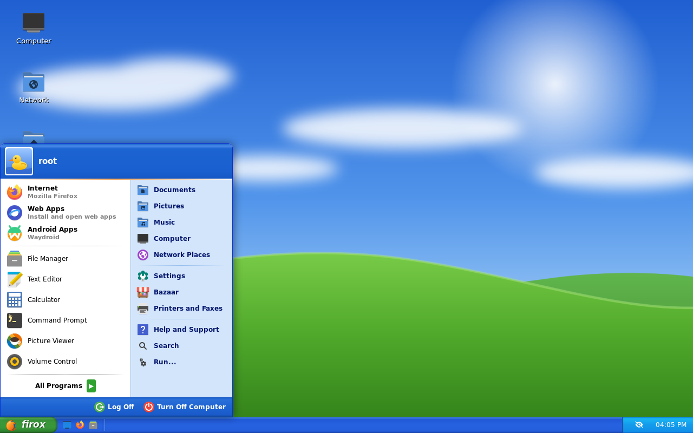
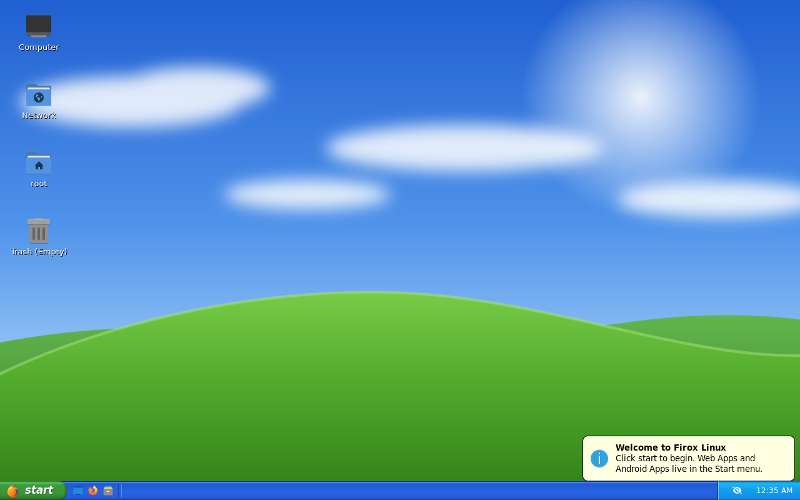
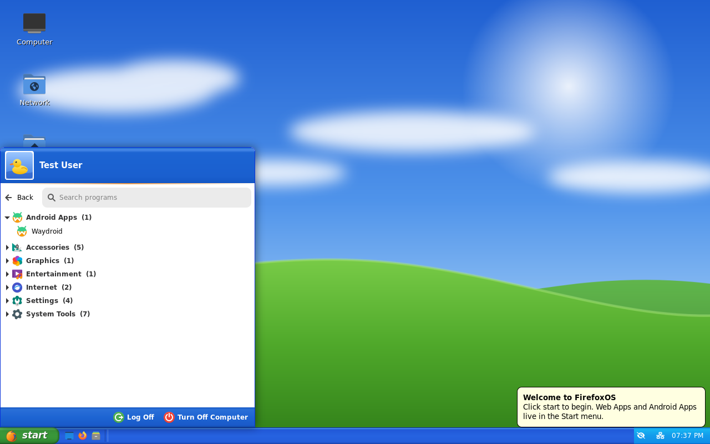
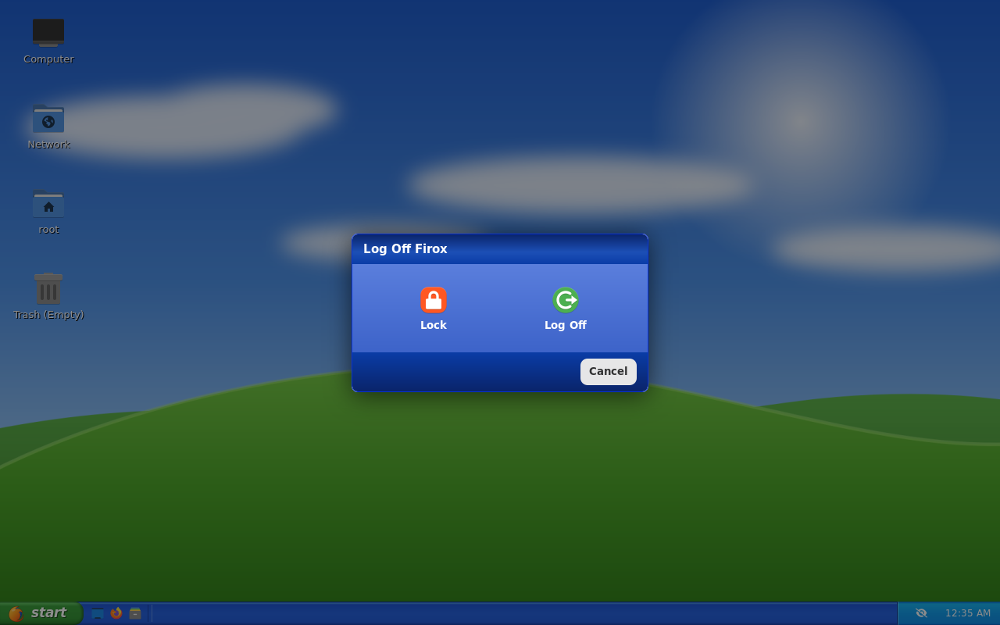
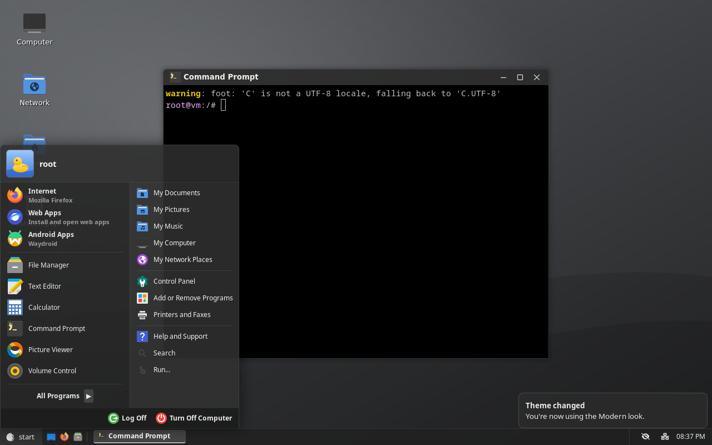
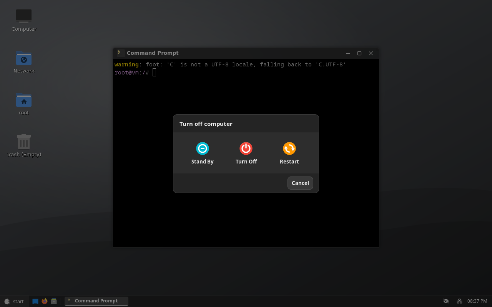
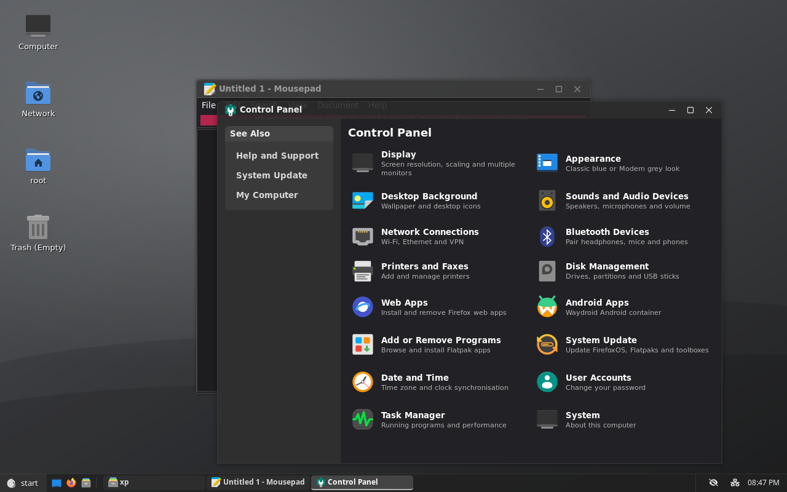

# FirefoxOS

A [Universal Blue](https://universal-blue.org/) image where **websites are the apps**. It's built on Fedora Atomic and uses:

- **Firefox + [PWAsForFirefox](https://pwasforfirefox.filips.si/)** (`firefoxpwa`): install any site as a desktop app with its own window, taskbar button and Start menu entry.
- **[Waydroid](https://waydro.id/)**: Android apps in a container, integrated into the Start menu.
- **A custom Wayland desktop laid out like the classic XP desktop**: blue "Luna"-style taskbar, green **start** button, a two-column Start menu, Quick Launch, notification area, desktop icons, and an XP-style login screen.

Everything (themes, icons, wallpaper, the Start menu) is original work. No Microsoft assets are used.



| Desktop | All Programs | Log Off |
|---|---|---|
|  |  |  |

### Classic or Modern

Same layout, two looks. **Modern** (the default) is grey, flat and translucent, with dark-mode apps. **Classic** is the blue and green one above:

| Modern Start menu | Modern Turn Off dialog |
|---|---|
|  |  |

Modern also switches apps to dark mode: GTK3 and GTK4/libadwaita apps, Firefox and web apps (which follow the system colour scheme), and Qt apps like the file manager. Classic switches them back to light.



Switch in **Control Panel → Appearance**, or with `ujust theme modern` / `ujust theme classic` (`firefoxos-theme set NAME` does the same). The change applies to the running desktop immediately and is saved per user. The wallpaper switches too, unless you've picked your own. The default for users who haven't picked one is set in `/etc/firefoxos/theme` (`modern`); change it to `classic` to make the XP look the default. On their first login, users get the default theme's wallpaper and light or dark app style.

<sub>Screenshots are from the built image running headless (`labwc` + `grim`).</sub>

## What's in the desktop

| Piece | What it is |
|---|---|
| Window manager | [labwc](https://labwc.github.io/) (wlroots, Openbox-style) with the `FirefoxOS-Luna` theme: blue gradient titlebars, rounded minimise/maximise/close buttons |
| Taskbar | [waybar](https://github.com/Alexays/Waybar): start button, Quick Launch, window buttons, tray, volume, network, battery, clock |
| Start menu | `firefoxos-startmenu`: Python + GTK3 + gtk-layer-shell. User picture header, pinned **Internet** / **Web Apps** / **Android Apps**, most-used programs, **All Programs** (grouped, with Web Apps and Android Apps folders, type to search), My Documents / Pictures / Music / Computer, Control Panel, Help, Search, Run, **Log Off** and **Turn Off Computer** dialogs |
| Desktop | `pcmanfm-qt --desktop`: wallpaper plus My Computer / Home / Recycle Bin / Network icons |
| Control Panel | `firefoxos-control-panel`: Display, Sound, Network, Bluetooth, Printers, Disks, Web Apps, Android, Add or Remove Programs, Date and Time, System... |
| Web Apps | `firefoxos-webapps`: list, open and remove installed PWAs |
| Login | greetd + gtkgreet (in cage), XP-style blue welcome screen |
| Extras | mako "balloon" notifications, fuzzel Run dialog, swaylock, foot "Command Prompt", htop "Task Manager" |

### Keyboard shortcuts

`Super` Start menu · `Super+E` My Computer · `Super+R` Run · `Super+D` show desktop · `Super+L` lock · `Super+←/→` snap · `Alt+Tab` switch windows · `Ctrl+Alt+Del` Task Manager · `PrtSc` screenshot

## Repository layout

```
Containerfile                 FROM ghcr.io/ublue-os/base-main, runs build.sh
build_files/build.sh          repos, packages, services, branding
system_files/                 copied onto / in the image
  etc/xdg/labwc/              compositor config, keybinds, autostart
  etc/xdg/waybar/             taskbar layout + Luna CSS
  etc/greetd/                 login screen
  etc/firefox/policies/       auto-installs the PWAsForFirefox extension
  usr/bin/firefoxos-*         start menu, control panel, web apps, helpers
  usr/share/themes/FirefoxOS-Luna/   window theme + SVG buttons
  usr/share/ublue-os/just/60-custom.just   `ujust` recipes
disk_config/                  qcow2 / ISO definitions for bootc-image-builder
Justfile                      local build helpers (from ublue image-template)
```

## Installing

### Rebase an existing Fedora Atomic / Universal Blue system

```bash
sudo bootc switch ghcr.io/kurodenkou/firefoxos:latest
```

```bash
systemctl reboot
```

### Fresh install from an ISO

Run **Actions → Build disk images** (`build-disk.yml`) in GitHub and download the `anaconda-iso` artifact, or build one locally:

```bash
just build-iso ghcr.io/kurodenkou/firefoxos latest
```

The installer creates your user account. There's no separate setup wizard.

### Try it in a VM

```bash
just build
```

```bash
just build-qcow2
```

```bash
just run-vm-qcow2
```

The qcow2 image has a test user `xp` with password `firefoxos` (set in `disk_config/disk.toml`).

## After first login

- **Web apps:** the Firefox runtime for web apps downloads in the background on first login. Open a site in Firefox, click the PWAsForFirefox toolbar button and choose **Install**.
- **Android:** open **Start → Android Apps**. The first time, it runs `ujust setup-waydroid` to download Android. Use `ujust setup-waydroid gapps` for the Play Store.
- **More apps:** **Control Panel → Add or Remove Programs** installs the Bazaar Flatpak store.

### `ujust` recipes

| Recipe | Does |
|---|---|
| `ujust setup-waydroid [vanilla\|gapps]` | Download and initialise Android |
| `ujust waydroid-google-id` | Print the Android ID to register a GAPPS install |
| `ujust reset-waydroid` | Delete Android and its data |
| `ujust fix-realtek-audio` | Fix silent/crackling Realtek onboard audio ([linux-audio-fix](https://github.com/hello2himel/linux-audio-fix), pinned + checksum-verified; also in Control Panel → Sound Troubleshooter) |
| `ujust install-webapp-runtime` | (Re)install the firefoxpwa Firefox runtime |
| `ujust install-app-store` | Install the Bazaar Flatpak store |
| `ujust customize-desktop` | Copy labwc/waybar defaults into `~/.config` to edit |
| `ujust reset-desktop` | Back up your overrides and restore defaults |
| `ujust theme [classic\|modern]` | Switch between the Classic and Modern look |

## Customising

Each look's styling lives in `/usr/share/firefoxos/themes/{classic,modern}/` (taskbar CSS, Start menu CSS, notifications, Run dialog, lock screen), with window themes in `/usr/share/themes/FirefoxOS-{Luna,Modern}`. To add a third look, copy one of those folders and edit it; it shows up in Control Panel → Appearance automatically. System defaults live in `/etc/xdg/{labwc,waybar,mako,foot,fuzzel}`. Anything you put in the matching `~/.config/` folder overrides them. The Start menu's pinned and default apps are at the top of `system_files/usr/bin/firefoxos-startmenu` (`PINNED`, `DEFAULT_MFU`). The menu also takes `--all-programs`, `--power` and `--log-off`, which you can bind to keys in `rc.xml`.

## Building and signing

GitHub Actions (`.github/workflows/build.yml`) builds and pushes `ghcr.io/<owner>/firefoxos` on every push to `main` and every day. To sign images, generate a key pair with `cosign generate-key-pair` and add the private key as the `SIGNING_SECRET` repository secret. Without it, the build still runs and signing is skipped.

## Known limitations

- Waydroid needs a GPU it supports (Intel/AMD are fine; NVIDIA's proprietary driver generally isn't) and doesn't work on Secure Boot setups that block the binder module from loading.
- The PWAsForFirefox extension is installed by Firefox policy on first launch, so Firefox needs network access the first time.
- The Start menu, Control Panel and Web Apps manager are new code and haven't been tested much on real hardware yet.
